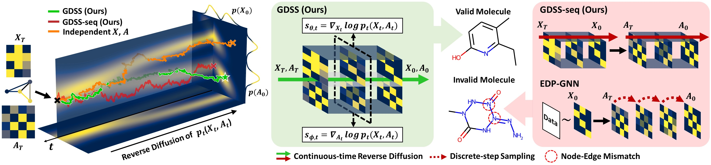

# Score-based Generative Modeling of Graphs via the System of Stochastic Differential Equations

Official Code Repository for the paper [Score-based Generative Modeling of Graphs via the System of Stochastic Differential Equations](https://arxiv.org/abs/2202.02514) (ICML 2022).

> 🔴**UPDATE**:  We provide an seperate code repo for **GDSS using Graph Transformer** [here](https://github.com/DongkiKim95/GDSS-Transformer)!

In this repository, we implement the *Graph Diffusion via the System of SDEs* (GDSS).

---

## Modifications for Directed Graph (DAG) Generation

This fork extends GDSS to support **directed graphs**, in particular weighted DAGs from linear Structural Equation Models (SEMs). The changes are fully **backward-compatible**: existing undirected-graph configs are unaffected.

### What changed

| File | Change |
|---|---|
| `utils/graph_utils.py` | `node_flags` now checks both in- and out-edges, so sink nodes (zero out-degree) are correctly marked active |
| `utils/graph_utils.py` | `adjs_to_graphs` accepts a `directed` flag and returns `nx.DiGraph` when set |
| `losses.py` | `get_sde_loss_fn` gains a `sym` parameter — when `False`, adjacency noise is drawn from a full N×N Gaussian instead of the upper-triangular symmetric distribution |
| `solver.py` | All predictor/corrector classes and both sampler factories (`get_pc_sampler`, `S4_solver`) gain a `sym` parameter; prior sampling switches from `prior_sampling_sym` to `prior_sampling` when `sym=False` |
| `models/attention.py` | `Attention` and `AttentionLayer` gain a `directed` flag; the `(A+Aᵀ)/2` and `_adj+_adjᵀ` symmetrisations are skipped when `directed=True` |
| `models/ScoreNetwork_A.py` | `ScoreNetworkA` gains a `directed` parameter and forwards it to every `AttentionLayer` |
| `utils/loader.py` | Reads `config.data.directed` (default `False`) and injects `directed` into model params and `sym=not directed` into loss/sampling functions; `load_eval_settings` skips undirected MMD metrics for directed graphs |
| `evaluation/mmd.py` | Fixed deprecated `np.float` → `float` (NumPy ≥ 1.24 compatibility) |
| `sampler.py` | Skips MMD evaluation (not defined for directed graphs) and uses `nx.DiGraph` for generated graph objects |

To enable directed-graph mode, add one line to your config:

```yaml
data:
  directed: true
```

### Generating SEM / DAG datasets

Two generation scripts are provided in `data/`:

**`data/generate_dag_pnp_data.py`** — uses `random_dag()` from the parent `dag-pnp` package (ERk convention, E[edges] = k·d):

```sh
# ER4, d=20, 700 graphs
python data/generate_dag_pnp_data.py --d 20 --k 4 --n_graphs 700
```

**`data/generate_sem_data.py`** — standalone generator for Erdős-Rényi and scale-free DAGs with weights in [−2,−0.5] ∪ [0.5, 2] (matches the original SEM benchmark):

```sh
# Erdős-Rényi, p=0.3
python data/generate_sem_data.py --graph_type ER --d 20 --n_graphs 700

# Scale-free (Barabási-Albert)
python data/generate_sem_data.py --graph_type SF --d 20 --n_graphs 700
```

Both scripts produce a `.pkl` file in `data/` containing a list of `nx.DiGraph` objects with float edge weights, ready to be consumed by the GDSS data loader.

### Training on directed graphs

```sh
CUDA_VISIBLE_DEVICES=0 python main.py --type train --config config/dag_pnp_er4_d20.yaml --seed 42
```

Ready-made configs are provided for d=20:

- `config/dag_pnp_er4_d20.yaml` — ER4 DAGs using `random_dag()`
- `config/sem_er_d20.yaml` — ER DAGs using the SEM benchmark generator

### Sampling from a trained directed model

1. Note the checkpoint timestamp printed at the end of training (e.g. `Apr12-02:59:53`).
2. Set `ckpt:` in `config/sample_sem_er_d20.yaml` (or copy it for your dataset).
3. Run:

```sh
CUDA_VISIBLE_DEVICES=0 python main.py --type sample --config config/sample_sem_er_d20.yaml --seed 42
```

Generated graphs are saved as `nx.DiGraph` objects. Standard MMD evaluation is skipped for directed graphs (undirected metrics such as spectral Laplacian and orbit counts are not defined for digraphs); use SHD / SID from `dag-pnp/data_utils.py` to evaluate DAG recovery quality.

---

<p align="center">
    
</p>

## Contribution

+ We propose a novel score-based generative model for graphs that overcomes the limitation of previous generative methods, by introducing a diffusion process for graphs that can generate node features and adjacency simultaneously via the system of SDEs.
+ We derive novel training objectives to estimate the gradient of the joint log-density for the proposed diffusion process and further introduce an efficient integrator to solve the proposed system of SDEs.
+ We validate our method on both synthetic and real-world graph generation tasks, on which ours outperforms existing graph generative models.

## Dependencies

GDSS is built in **Python 3.7.0** and **Pytorch 1.10.1**. Please use the following command to install the requirements:

```sh
pip install -r requirements.txt
```

For molecule generation, additionally run the following command:

```sh
conda install -c conda-forge rdkit=2020.09.1.0
```


## Running Experiments


### 1. Preparations

We provide four **generic graph datasets** (Ego-small, Community_small, ENZYMES, and Grid) and two **molecular graph datasets** (QM9 and ZINC250k). 

We additionally provide the commands for generating generic graph datasets as follows:

```sh
python data/data_generators.py --dataset ${dataset_name}
```

To preprocess the molecular graph datasets for training models, run the following command:

```sh
python data/preprocess.py --dataset ${dataset_name}
python data/preprocess_for_nspdk.py --dataset ${dataset_name}
```

For the evaluation of generic graph generation tasks, run the following command to compile the ORCA program (see http://www.biolab.si/supp/orca/orca.html):

```sh
cd evaluation/orca 
g++ -O2 -std=c++11 -o orca orca.cpp
```


### 2. Configurations

The configurations are provided on the `config/` directory in `YAML` format. 
Hyperparameters used in the experiments are specified in the Appendix C of our paper.


### 3. Training

We provide the commands for the following tasks: Generic Graph Generation and Molecule Generation.

To train the score models, first modify `config/${dataset}.yaml` accordingly, then run the following command.

```sh
CUDA_VISIBLE_DEVICES=${gpu_ids} python main.py --type train --config ${train_config} --seed ${seed}
```

for example, 

```sh
CUDA_VISIBLE_DEVICES=0 python main.py --type train --config community_small --seed 42
```
and
```sh
CUDA_VISIBLE_DEVICES=0,1 python main.py --type train --config zinc250k --seed 42
```

### 4. Generation and Evaluation

To generate graphs using the trained score models, run the following command.

```sh
CUDA_VISIBLE_DEVICES=${gpu_ids} python main.py --type sample --config sample_qm9
```
or
```sh
CUDA_VISIBLE_DEVICES=${gpu_ids} python main.py --type sample --config sample_zinc250k
```


## Pretrained checkpoints

We provide checkpoints of the pretrained models on the `checkpoints/` directory, which are used in the main experiments.

+ `ego_small/gdss_ego_small.pth`
+ `community_small/gdss_community_small.pth`
+ `ENZYMES/gdss_enzymes.pth`
+ `grid/gdss_grid.pth`
+ `QM9/gdss_qm9.pth`
+ `ZINC250k/gdss_zinc250k.pth` 

We also provide a checkpoint of improved GDSS that uses GMH blocks instead of GCN blocks in $s_{\theta,t}$ (i.e., that uses `ScoreNetworkX_GMH` instead of `ScoreNetworkX`). The numbers of training epochs are 800 and 1000 for $s_{\theta,t}$ and $s_{\phi,t}$, respectively. For this checkpoint, use Rev. + Langevin solver and set `snr` as 0.2 and `scale_eps` as 0.8.

+ `ZINC250k/gdss_zinc250k_v2.pth` 

## Citation

If you found the provided code with our paper useful in your work, we kindly request that you cite our work.

```BibTex
@article{jo2022GDSS,
  author    = {Jaehyeong Jo and
               Seul Lee and
               Sung Ju Hwang},
  title     = {Score-based Generative Modeling of Graphs via the System of Stochastic
               Differential Equations},
  journal   = {arXiv:2202.02514},
  year      = {2022},
  url       = {https://arxiv.org/abs/2202.02514}
}
```
